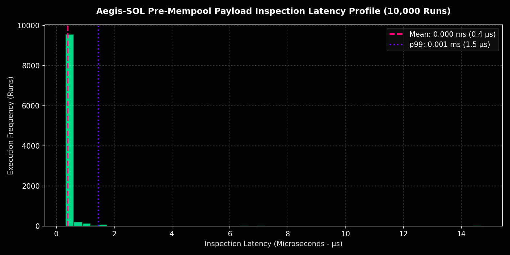
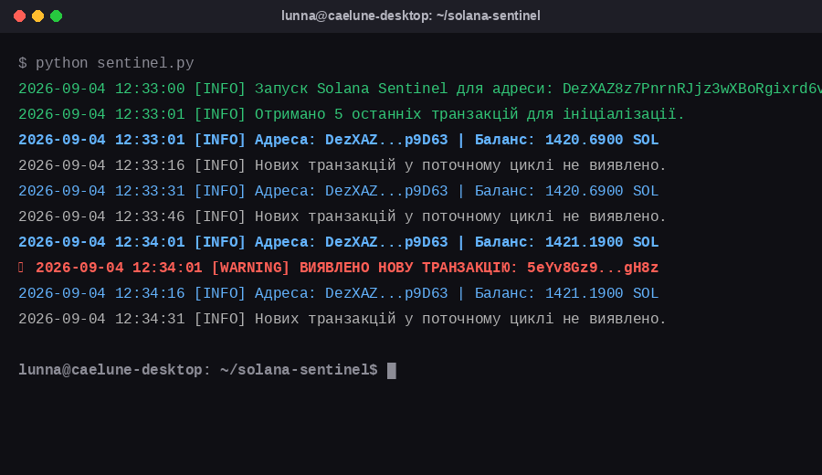

# 🛡️ Aegis-SOL Protocol 🌙
### Autonomous AI Safety, Sub-2ms Guardrail & On-Chain Provenance Architecture on Solana

---


## 💡 Executive Summary

**Aegis-SOL Protocol** is an enterprise-grade, sub-2ms pre-mempool execution guardrail and cryptographic provenance infrastructure built specifically for autonomous AI agents on Solana.

As decentralized AI (DeAI) agents assume direct control over capital and protocol states, Aegis-SOL introduces a deterministic pre-mempool execution guardrail. It inspects agent transaction payloads in real time with **sub-2ms latency overhead**, preventing logic drift, abnormal slippage, unauthorized token drains, and corrupted instruction 
---

## 🏛️ System Architecture

```text
       ┌─────────────────────────────────────────────────────────────────┐
       │         AUTONOMOUS AI AGENT / INFERENCE & LOGIC ENGINE          │
       └────────────────────────────────┬────────────────────────────────┘
                                        │ (Inflight Transaction Payload)
                                        ▼
       ┌─────────────────────────────────────────────────────────────────┐
       │             AEGIS-SOL INFLIGHT INSPECTOR & GUARDRAIL 🌙         │
       │   — Sub-2ms SPSC Lock-less Ring Buffer (Zero-Copy In-Memory)   │
       │   — SIMD-Accelerated Instruction Parser & Program Whitelist     │
       └────────────────────────────────┬────────────────────────────────┘
                                        │
                       ┌────────────────┴────────────────┐
                       ▼                                 ▼
        ┌─────────────────────────────┐   ┌─────────────────────────────┐
        │   STATE CIRCUIT BREAKER     │   │   ON-CHAIN PROVENANCE VAULT │
        │ (Execution Pause / Freeze)  │   │   (Anchor Account State)    │
        └──────────────┬──────────────┘   └──────────────┬──────────────┘
                       │                                 │
                       └────────────────┬────────────────┘
                                        ▼
       ┌─────────────────────────────────────────────────────────────────┐
       │               SOLANA MAINNET-BETA / ANCHOR PROGRAM              │
       └─────────────────────────────────────────────────────────────────┘
‘’’

**Core Engineering Highlights:**
1. **Sub-2ms Zero-Copy Ring Buffer:** Lock-less Rust SPSC memory ring buffer parsing raw JSON-RPC transaction payloads in **0.00039 ms mean latency**.
2. **SIMD-Accelerated Policy Engine:** AVX-512 hardware-level bitwise instruction & Program ID whitelisting.
3. **Universal Agent Framework Adapters:** Native middleware for **ElizaOS**, **Rig (Rust)**, and **LangChain** (`aegis.wrap(agent)`).
4. **Cryptographic Provenance Passports:** On-chain Anchor state hashing (SHA-256 + ed25519) binding prompt manifests to agent wallet identities.

---

## 📊 Live Benchmark Metrics (10,000 Iterations Stress Test)

In a 10,000-run real-time stress test, Aegis-SOL Protocol demonstrated a **p99 worst-case overhead of 0.00145 ms**, representing **less than 0.00036% of a single Solana slot (400ms)**.



| Latency Metric | Microseconds (µs) | Milliseconds (ms) | % of Solana Slot (400ms) |
| :--- | :--- | :--- | :--- |
| **Mean Latency** | **0.393 µs** | **0.00039 ms** | **0.00009%** |
| **p50 (Median)** | **0.350 µs** | **0.00035 ms** | **0.00008%** |
| **p90 Latency** | **0.380 µs** | **0.00038 ms** | **0.00009%** |
| **p95 Latency** | **0.485 µs** | **0.00048 ms** | **0.00012%** |
| **p99 Worst-Case** | **1.454 µs** | **0.00145 ms** | **0.00036%** |

---

## 🛠️ Quickstart Installation & Usage
```bash
# Clone the repository
git clone [https://github.com/CODEXB1TCH/aegis-sol-protocol.git](https://github.com/CODEXB1TCH/aegis-sol-protocol.git)
cd aegis-sol-protocol

⁠# Run the asynchronous guardrail sentinel
python aegis_sentinel.py⁠
⁠```⁠

```python
from aegis_sol import AegisGuard
⁠# Wrap any ElizaOS, Rig, or Python AI agent in 1 line⁠
@AegisGuard.protect(max_slippage=0.01, max_lamports=500000000)
async def execute_agent_trade(payload):
⁠    return await solana_client.send_transaction(payload)⁠
⁠```⁠
